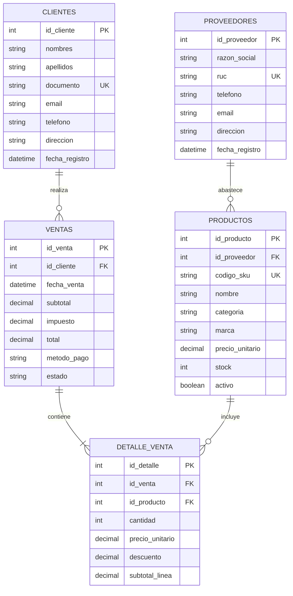

# Diccionario de datos y Diagrama Entidad-Relación

Sistema para Venta de Computadoras — diseño conceptual y lógico.

---

## 1. Diccionario de datos

### 1.1 Tabla: `proveedores`

| Campo            | Tipo           | Nulo | Clave | Descripción                              |
|------------------|----------------|------|-------|------------------------------------------|
| id_proveedor     | INT            | NO   | PK    | Identificador único del proveedor        |
| razon_social     | VARCHAR(150)   | NO   |       | Nombre legal de la empresa               |
| ruc              | VARCHAR(20)    | NO   | UQ    | Número de identificación tributaria      |
| telefono         | VARCHAR(20)    | SÍ   |       | Teléfono de contacto                     |
| email            | VARCHAR(100)   | SÍ   |       | Correo electrónico                       |
| direccion        | VARCHAR(200)   | SÍ   |       | Dirección física                         |
| fecha_registro   | DATETIME       | NO   |       | Fecha de alta en el sistema              |

### 1.2 Tabla: `productos`

| Campo            | Tipo           | Nulo | Clave | Descripción                                      |
|------------------|----------------|------|-------|--------------------------------------------------|
| id_producto      | INT            | NO   | PK    | Identificador único del producto                 |
| id_proveedor     | INT            | NO   | FK    | Proveedor que abastece el producto               |
| codigo_sku       | VARCHAR(50)    | NO   | UQ    | Código de inventario (SKU)                       |
| nombre           | VARCHAR(150)   | NO   |       | Nombre comercial del producto                    |
| categoria        | VARCHAR(80)    | NO   |       | Categoría (Laptop, Desktop, Monitor, etc.)       |
| marca            | VARCHAR(80)    | NO   |       | Marca del fabricante                             |
| precio_unitario  | DECIMAL(12,2)  | NO   |       | Precio de venta unitario (> 0)                   |
| stock            | INT            | NO   |       | Cantidad disponible en inventario (≥ 0)          |
| activo           | TINYINT(1)     | NO   |       | 1 = disponible para venta, 0 = descontinuado     |

### 1.3 Tabla: `clientes`

| Campo            | Tipo           | Nulo | Clave | Descripción                              |
|------------------|----------------|------|-------|------------------------------------------|
| id_cliente       | INT            | NO   | PK    | Identificador único del cliente          |
| nombres          | VARCHAR(100)   | NO   |       | Nombres del cliente                      |
| apellidos        | VARCHAR(100)   | NO   |       | Apellidos del cliente                    |
| documento        | VARCHAR(20)    | NO   | UQ    | DNI / CE / RUC del cliente               |
| email            | VARCHAR(100)   | SÍ   |       | Correo electrónico                       |
| telefono         | VARCHAR(20)    | SÍ   |       | Teléfono de contacto                     |
| direccion        | VARCHAR(200)   | SÍ   |       | Dirección de facturación/envío           |
| fecha_registro   | DATETIME       | NO   |       | Fecha de alta en el sistema              |

### 1.4 Tabla: `ventas`

| Campo            | Tipo           | Nulo | Clave | Descripción                                      |
|------------------|----------------|------|-------|--------------------------------------------------|
| id_venta         | INT            | NO   | PK    | Identificador único de la venta                  |
| id_cliente       | INT            | NO   | FK    | Cliente que realiza la compra                    |
| fecha_venta      | DATETIME       | NO   |       | Fecha y hora de la transacción                   |
| subtotal         | DECIMAL(12,2)  | NO   |       | Suma de líneas antes de impuestos                |
| impuesto         | DECIMAL(12,2)  | NO   |       | Monto de impuesto (IGV u otro)                   |
| total            | DECIMAL(12,2)  | NO   |       | Monto total a pagar                              |
| metodo_pago      | VARCHAR(40)    | NO   |       | Efectivo, Tarjeta, Transferencia, etc.           |
| estado           | VARCHAR(20)    | NO   |       | Pendiente, Completada, Anulada                   |

### 1.5 Tabla: `detalle_venta`

| Campo            | Tipo           | Nulo | Clave | Descripción                                      |
|------------------|----------------|------|-------|--------------------------------------------------|
| id_detalle       | INT            | NO   | PK    | Identificador único de la línea                  |
| id_venta         | INT            | NO   | FK    | Venta a la que pertenece la línea                |
| id_producto      | INT            | NO   | FK    | Producto vendido                                 |
| cantidad         | INT            | NO   |       | Unidades vendidas (> 0)                          |
| precio_unitario  | DECIMAL(12,2)  | NO   |       | Precio aplicado al momento de la venta           |
| descuento        | DECIMAL(12,2)  | NO   |       | Descuento aplicado a la línea (≥ 0)              |
| subtotal_linea   | DECIMAL(12,2)  | NO   |       | (cantidad × precio) − descuento                  |

---

## 2. Modelo relacional (resumen)

```
proveedores (1) ──── (N) productos
clientes    (1) ──── (N) ventas
ventas      (1) ──── (N) detalle_venta
productos   (1) ──── (N) detalle_venta
```

---

## 3. Diagrama Entidad-Relación (Mermaid.js)



---

## 4. Reglas de negocio relevantes

1. Un producto siempre pertenece a un proveedor.
2. Una venta siempre pertenece a un cliente y tiene al menos un detalle.
3. El stock de un producto no puede ser negativo.
4. El precio unitario y las cantidades deben ser mayores a cero.
5. Al registrar una venta completada, el stock de cada producto se descuenta según la cantidad vendida.
6. Una venta anulada no debe afectar (o debe revertir) el inventario.
