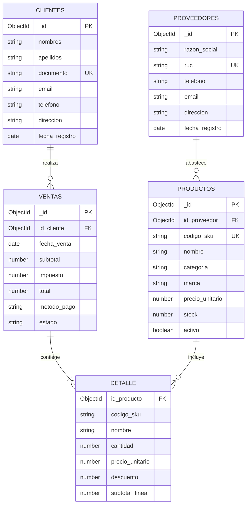

# Diccionario de datos y Diagrama (MongoDB)

Sistema para Venta de Computadoras — modelo documental.

---

## 1. Diccionario de datos

### 1.1 Colección: `proveedores`

| Campo           | Tipo     | Descripción                         |
|-----------------|----------|-------------------------------------|
| `_id`           | ObjectId | Identificador único                 |
| `razon_social`  | String   | Nombre legal de la empresa          |
| `ruc`           | String   | RUC (único)                         |
| `telefono`      | String   | Teléfono de contacto                |
| `email`         | String   | Correo electrónico                  |
| `direccion`     | String   | Dirección física                    |
| `fecha_registro`| Date     | Fecha de alta                       |

### 1.2 Colección: `productos`

| Campo             | Tipo     | Descripción                              |
|-------------------|----------|------------------------------------------|
| `_id`             | ObjectId | Identificador único                      |
| `id_proveedor`    | ObjectId | Referencia a `proveedores`               |
| `codigo_sku`      | String   | SKU (único)                              |
| `nombre`          | String   | Nombre comercial                         |
| `categoria`       | String   | Laptop, Desktop, Monitor, etc.           |
| `marca`           | String   | Marca del fabricante                     |
| `precio_unitario` | Number   | Precio de venta (> 0)                    |
| `stock`           | Number   | Unidades disponibles (≥ 0)               |
| `activo`          | Boolean  | Disponible para venta                    |

### 1.3 Colección: `clientes`

| Campo            | Tipo     | Descripción                 |
|------------------|----------|-----------------------------|
| `_id`            | ObjectId | Identificador único         |
| `nombres`        | String   | Nombres                     |
| `apellidos`      | String   | Apellidos                   |
| `documento`      | String   | DNI/CE (único)              |
| `email`          | String   | Correo                      |
| `telefono`       | String   | Teléfono                    |
| `direccion`      | String   | Dirección                   |
| `fecha_registro` | Date     | Fecha de alta               |

### 1.4 Colección: `ventas`

| Campo          | Tipo     | Descripción                                      |
|----------------|----------|--------------------------------------------------|
| `_id`          | ObjectId | Identificador único                              |
| `id_cliente`   | ObjectId | Referencia a `clientes`                          |
| `fecha_venta`  | Date     | Fecha y hora                                     |
| `subtotal`     | Number   | Suma de líneas                                   |
| `impuesto`     | Number   | IGV u otro                                       |
| `total`        | Number   | Total a pagar                                    |
| `metodo_pago`  | String   | Efectivo, Tarjeta, Transferencia, Yape           |
| `estado`       | String   | Pendiente, Completada, Anulada                   |
| `detalle`      | Array    | Líneas de venta embebidas                        |

#### Elemento de `detalle[]`

| Campo             | Tipo     | Descripción                |
|-------------------|----------|----------------------------|
| `id_producto`     | ObjectId | Referencia a `productos`   |
| `codigo_sku`      | String   | SKU al momento de la venta |
| `nombre`          | String   | Nombre del producto        |
| `cantidad`        | Number   | Unidades (> 0)             |
| `precio_unitario` | Number   | Precio aplicado            |
| `descuento`       | Number   | Descuento de línea (≥ 0)   |
| `subtotal_linea`  | Number   | (cantidad × precio) − desc.|

---

## 2. Relaciones (referencias + embebido)

```
proveedores (1) ──── (N) productos     [referencia id_proveedor]
clientes    (1) ──── (N) ventas        [referencia id_cliente]
ventas      (1) ──── (N) detalle[]     [array embebido]
productos   (1) ──── (N) detalle.id_producto
```

---

## 3. Diagrama de colecciones (Mermaid)



---

## 4. Reglas de negocio

1. Todo producto referencia un proveedor (`id_proveedor`).
2. Toda venta referencia un cliente y tiene al menos un elemento en `detalle`.
3. El stock no debe ser negativo.
4. Al completar una venta se descuenta stock por cada línea.
5. El detalle va **embebido** en `ventas` (lectura rápida del ticket).
